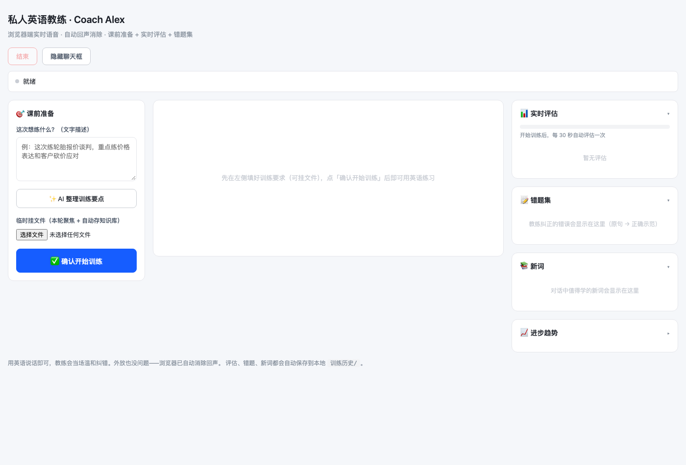

# 私人英语教练 · English Voice Coach

一个跑在 macOS 本地的 **AI 英语口语教练**，用**实时语音**跟你对话练习口语。它会像专业老师一样：当场温和纠错、实时评估你的英语水平（CEFR 等级）、记录错题和新词，训练结束后自动生成报告，还能跨天汇总你的**长期进步趋势**。

> 学习数据（对话记录、评估、错题、报告）全部落盘本地，不锁在云端；语音识别/合成走阿里云百炼实时语音模型。



## 核心功能

| 功能 | 说明 |
|---|---|
| 🎙️ **实时语音对话** | 端到端语音对话，浏览器内核自动回声消除（外放、不戴耳机也不回环） |
| 👨‍🏫 **教练人设 + 知识库** | Coach Alex 人设（温和纠错、正常语速）；本地知识库文件夹，支持 md/txt/csv/xlsx/pdf |
| 🎯 **课前准备** | 训练前用文字定主题（可「AI 整理训练要点」），可临时挂文件（本轮聚焦 + 自动存知识库） |
| 📊 **实时评估** | 每 30 秒评估一次，输出 CEFR 等级（A1-C2）+ 语法/流利/词汇三维打分 |
| 📝 **错题集** | 自动提取「✗ 原句 → ✓ 正确示范」+ 错误类型 |
| 📚 **新词** | 自动提取值得学的新词（词 + 释义 + 例句） |
| 📄 **训练报告** | 点「结束」自动生成 Markdown 报告（水平趋势 + 错题 + 新词 + 对话记录） |
| 📈 **进步趋势** | 跨天汇总历史评估，折线图展示三维分数随时间变化 + CEFR 轨迹 |

## 技术架构

```
┌─ 浏览器 (index.html) ─────────────────────────────┐
│  getUserMedia + RTCPeerConnection (WebRTC, 消回声) │
│  课前准备 / 聊天框 / 评估侧栏 / 进步趋势(Canvas)    │
└──────────────┬────────────────────────────────────┘
               │ /signal /config /assess /progress /log /report /upload
┌──────────────▼───────────────┐   ┌──────────────────┐
│ 本地服务 (server.py, 8766)    │──▶│ 阿里云百炼实时语音  │
│ 信令代理 / 知识库扫描 / 报告   │   │ qwen-audio-3.0-   │
└──────────────┬───────────────┘   │ realtime-plus     │
               │                   └──────────────────┘
               │ /assess /summarize
┌──────────────▼───────────────┐
│ 本地 Ollama (qwen3.5:9b)     │
│ CEFR 评估 / 纠错 / 新词提取   │
└──────────────────────────────┘
```

- **语音底座**：阿里云百炼 Token Plan 实时语音 `qwen-audio-3.0-realtime-plus`（WebRTC 协议，浏览器内核自带 AEC 回声消除 + 降噪）
- **本地评估**：Ollama `qwen3.5:9b`（关思考模式）做 CEFR 等级判断、语法/流利/词汇打分、纠错和新词提取
- **落盘**：`训练历史/YYYY-MM-DD.jsonl`（对话流 + 评估 + 纠错 + 新词）、`训练历史/报告/*.md`（训练报告）

## 快速开始

```bash
# 双击「启动英语教练.command」即可（自动起服务 + 开浏览器），无需打开任何 AI 工具
# 或手动：
~/Applications/anaconda3/envs/qwen-data-video/bin/python server.py
# 浏览器打开 http://127.0.0.1:8766/
```

关掉浏览器后，服务会**约 60 秒后自动退出**（心跳 + 空闲退出机制）。

## 使用流程

1. **课前准备**（左栏）：文字写这次练什么 →（可选）点「✨ AI 整理训练要点」→（可选）挂临时文件
2. 点「✅ 确认开始训练」→ 授权麦克风 → 开始用英语对话
3. 训练中：右侧每 30 秒自动评估一次（CEFR 等级），错题/新词自动记录
4. 练完点「结束」→ 自动生成报告

## 目录结构

```
私人英语教练/
├── server.py                # 本地服务（信令代理 + 知识库 + 评估 + 报告）
├── index.html               # 浏览器界面（三栏：课前准备 | 聊天框 | 评估侧栏）
├── 人设.md                  # 教练 Alex 人设
├── 知识库/                  # 训练背景资料（md/txt/csv/xlsx/pdf，不上传）
├── 训练历史/                # 对话记录 + 报告（隐私，不上传）
├── 启动英语教练.command     # 双击启动
├── docs/screenshot.png      # 界面截图
└── README.md
```

## 隐私与安全

- **API key 不硬编码**：百炼 key 存 macOS Keychain（`security find-generic-password -s bailian-token-plan-key`），`server.py` 运行时动态读取，代码里没有任何明文 key。
- **学习数据全本地**：对话、评估、错题、报告都只落在你机器上，`.gitignore` 明确排除了 `训练历史/` 和 `知识库/`。

## 技术栈

- 前端：原生 HTML/CSS/JS，`getUserMedia` + `RTCPeerConnection`（WebRTC）+ Canvas 折线图
- 后端：Python 标准库 `http.server`（零 Web 框架依赖）
- 语音：阿里云百炼 Token Plan 实时语音（WebSocket 信令 + WebRTC 音频）
- 本地推理：Ollama `qwen3.5:9b`
